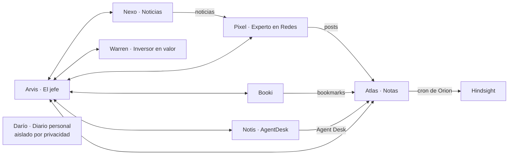

# Grok Bot

Índice de los agentes de Grok Bot.

## Agentes

| Agente | Rol | Nota |
|---|---|---|
| Arvis · El jefe | Asistente personal y coordinador | [[Arvis - El jefe]] |
| Nexo · Noticias | Noticias de tecnología, IA, ciencia y actualidad | [[Nexo - Noticias]] |
| Pixel · Experto en Redes | Publicaciones en LinkedIn, X e Instagram | [[Pixel - Experto en Redes]] |
| Atlas · Notas | Conocimiento y segundo cerebro en Obsidian | [[Atlas - Notas]] |
| Darío · Mi diario personal | Diario personal (privado) | [[Darío - Diario personal]] |
| Warren · Inversor en valor | Asesor de inversión en valor | [[Warren - Inversor en valor]] |
| Notis · AgentDesk | Copia de seguridad de Agent Desk | [[Notis - AgentDesk]] |
| Booki | Bookmarks de X | [[Booki - Bookmarks de X]] |

## Flujo entre agentes

Darío queda aislado por privacidad: solo habla con Kike; Arvis puede escribirle, pero no aparece en el flujo de datos con el resto.

## Relacionado

- [[Rutinas y cronjobs]]
